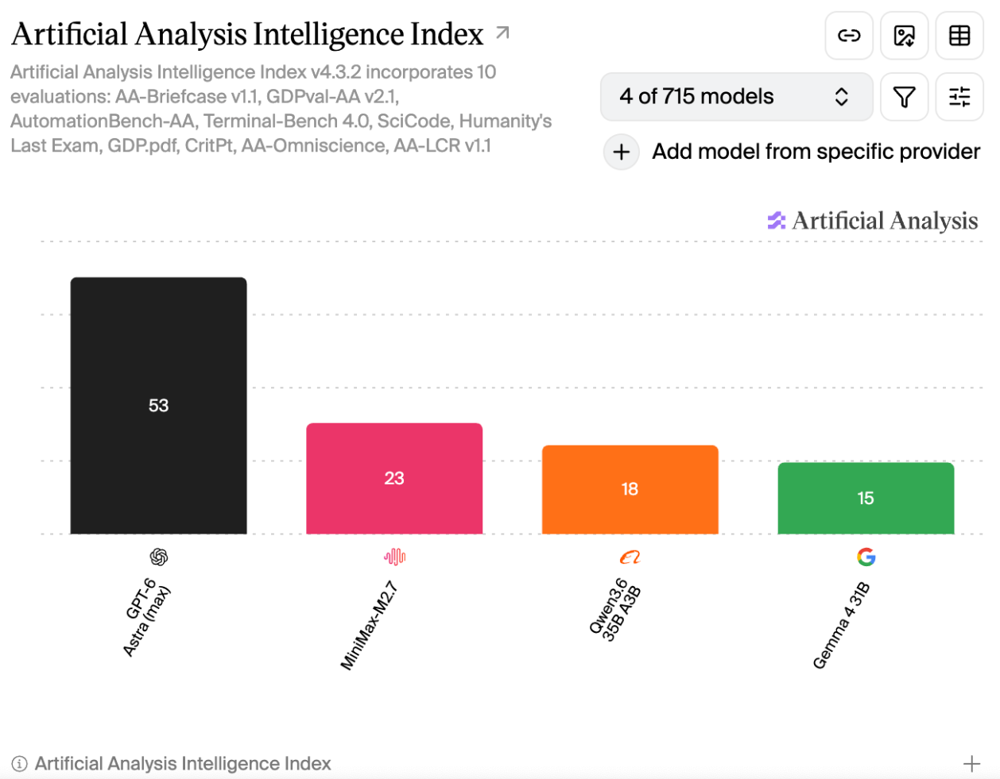

# Replicating Maulik & San, 2016 Preprint with agentic workflows

## Paper
[Maulik & San 2016](https://arxiv.org/abs/1604.08646)

## Test Prompts
- Read this paper and reproduce its results using the pi-feynman replication
  skill: [[1605.04593] An explicit relaxation filtering framework based upon
  Perona-Malik anisotropic diffusion for shock capturing and subgrid scale
  modeling of Burgers turbulence]. 
- Use subagent workflows with pi-subagents when you understand the paper,
  reproduce the work, self review the results and write the report and other
  tasks that require multi-agent workflows. Use the same model as the current
  model for all subagents. 
- Save the code and experimental outputs, and write a report comparing your
  results with the paper, explaining any discrepancies or results you couldn't
  reproduce. 
- Keep the work in a folder named after the llm model used in the current
  session

## Models

- GPT-6-Astra
- MiniMax M2.7
- Qwen3.6-35B-A3B-AWQ-4bit
- Google Gemma 4 31B
    - Gemma 4 did not generate a report.
    - The reason for failure to generate a report is that Gemma 4 did not
      implement the numerical solver correctly, and the solver would run for
      very long time (at least 2 hours). Gemma 4 did not set proper safeguard
      or checks or monitoring, and simply kept waiting. 

## Harness
[Pi Coding Agent](https://pi.dev/) is the agent code. 

Disclaimer: since this is the first test, components of harness, including
system prompts, skills, extensions, are the ones already used by the author for
daily uses. It is not a freshly installed pi harness. For example, in
newly-installed pi, there is no web search, or subagents. However, the same
harness is used for all models tested here.
